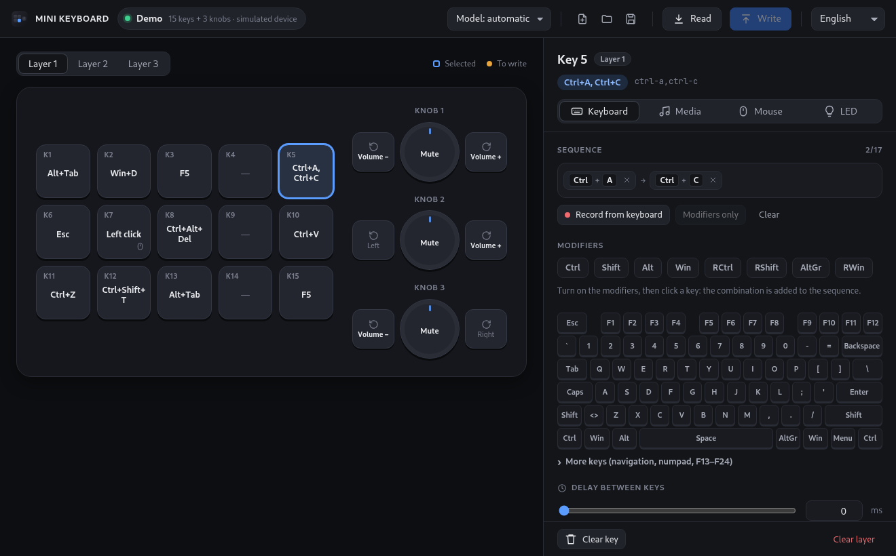
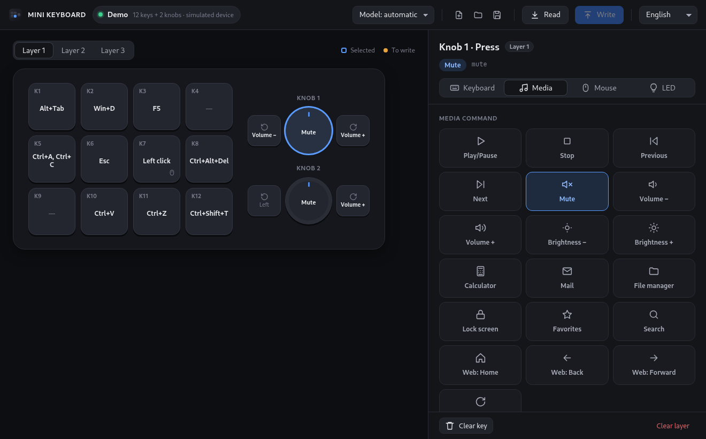
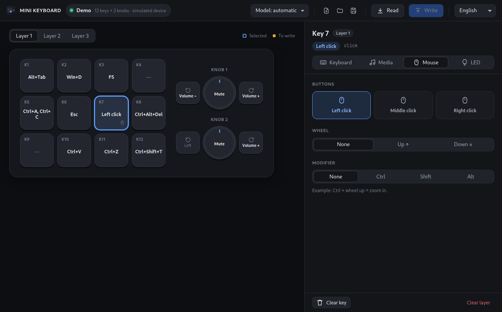
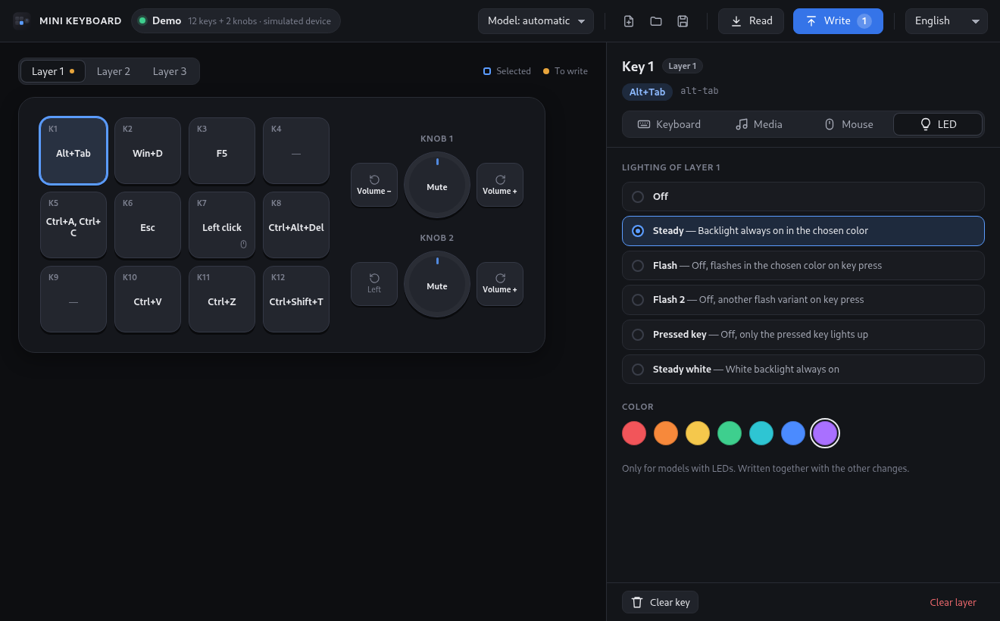

<div align="center">


# MINI KEYBOARD for Linux

**Program your cheap USB macro pad on Linux — keys, knobs, media keys, mouse actions and RGB, no Windows needed.**

The open-source Linux replacement for the `MINI_KEYBOARD.exe` / `MINI_KEYBOARD.app` configuration
software that ships with the 3-, 4-, 6-, 9-, 12- and 15-key macro keypads with rotary encoders sold on
AliExpress and Amazon.

[](LICENSE)


<picture>
  <source media="(prefers-color-scheme: light)" srcset="docs/screenshot-light.png">
  
</picture>

</div>

## Why

You bought one of those inexpensive **programmable mini keyboards** (a "macro pad", "macro keyboard",
"shortcut keypad", "one-handed keyboard" or "knob keyboard") and the seller pointed you to a Windows
`.exe` on Google Drive. This app does the same job **natively on Linux**, with a clean modern UI:

- 🎹 **Remap every key and knob** — key combos (`Ctrl+C`), whole macros (`Ctrl+A, Ctrl+C`) with a
  delay between keystrokes, up to 17 chords per key
- 🔊 **Media keys** — volume, mute, play/pause, next/previous, brightness, calculator, browser…
- 🖱️ **Mouse actions** — left/right/middle click, scroll wheel, `Ctrl` + scroll for zoom
- 💡 **RGB / LED backlight** — mode and colour for each layer
- 🗂️ **3 layers**, switchable from the pad's layer button
- ⌨️ **Record from your keyboard** — press the shortcut on your PC keyboard; works with any layout
  (Italian, German, French… it uses physical key codes)
- 📥 **Read back** the configuration stored in the pad, write **only what changed**
- 💾 **Profiles** as JSON, compatible with the [macropad_tool](https://github.com/kamaaina/macropad_tool) key syntax
- 🔌 **No root, no libusb, no driver detaching** — talks to `/dev/hidraw` directly; the pad keeps
  typing while you configure it
- 🧪 **Demo mode** — try everything without a device: `minikeyboard --demo 12x2`

## Tour

<table>
  <tr>
    <td width="50%"></td>
    <td width="50%"></td>
  </tr>
  <tr>
    <td align="center"><b>Keys &amp; macros</b> — chords, sequences, delays, recording</td>
    <td align="center"><b>Media keys</b> — volume knob, play/pause, brightness…</td>
  </tr>
  <tr>
    <td></td>
    <td></td>
  </tr>
  <tr>
    <td align="center"><b>Mouse</b> — clicks, scroll, Ctrl + scroll zoom</td>
    <td align="center"><b>RGB lighting</b> — six modes, seven colours, per layer</td>
  </tr>
</table>

## Supported devices

Every model handled by the vendor's MINI_KEYBOARD software:

| USB Vendor ID | USB Product IDs |
|---|---|
| `1189` | `8830` `8831` `8832` `8833` `8840` `8842` `8850` `8851` |
| `514C` | `8830` `8831` `8832` `8833` `8840` `8842` `8850` `8851` |

Check yours with `lsusb` — e.g. `ID 1189:8840 Acer Communications & Multimedia`.

Layouts recognised automatically: **1, 2, 3, 4, 5, 6, 9, 11, 12, 15, 16 and 21 keys**, with
**0 to 4 knobs** (rotary encoders with push button): 3+1, 4+1, 4+3, 6+1, 6+2, 9+2, 9+3, 11+3, 12+2,
12+3, 12+4, 15+3, 21+1, knob-only pads (1, 2 or 3 knobs) and more. Unknown combinations can be
picked by hand.

Not supported: the older `1189:8890` pads, which use a different protocol — use
[macropad_tool](https://github.com/kamaaina/macropad_tool) for those.

## Install

### From source (any distro)

You need Rust (via [rustup](https://rustup.rs)) and the WebKitGTK development files:

```sh
# Arch / Manjaro / EndeavourOS
sudo pacman -S --needed base-devel pkgconf webkit2gtk-4.1
# Debian / Ubuntu / Mint / Pop!_OS
sudo apt install build-essential pkg-config libwebkit2gtk-4.1-dev libgtk-3-dev libsoup-3.0-dev libssl-dev
# Fedora
sudo dnf install gcc pkgconf-pkg-config webkit2gtk4.1-devel gtk3-devel libsoup3-devel openssl-devel
```

Then:

```sh
git clone https://github.com/birdack/minikeyboard-linux.git
cd minikeyboard-linux
./install.sh
```

`install.sh` builds a release binary, installs it for your user (`~/.local/bin/minikeyboard`), adds
**MINI KEYBOARD** to your application menu and offers to install the udev rule (asks before using
`sudo`). `./install.sh --remove` uninstalls.

### Debian / Ubuntu package

Build a `.deb` that installs the app, the menu entry and the udev rule system-wide:

```sh
cd src-tauri
npx --yes @tauri-apps/cli@2 build --bundles deb
sudo apt install ./target/release/bundle/deb/*.deb
```

### Allow access without root (udev)

Linux only lets root write to HID devices unless a udev rule says otherwise. The rule in
[`data/70-minikeyboard.rules`](data/70-minikeyboard.rules) grants access to the user logged in at the
seat (`uaccess`), for the IDs above only:

```sh
sudo install -m 644 data/70-minikeyboard.rules /etc/udev/rules.d/
sudo udevadm control --reload && sudo udevadm trigger
```

Unplug and replug the pad afterwards. The `.deb` package installs this rule for you.

## Usage

1. Plug in the macro pad — it is detected and drawn with the right number of keys and knobs.
2. Pick a **layer** (1–3), click a **key** or a part of a **knob** (rotate left / press / rotate right).
3. Choose what it does: **Keyboard** (keys and macros), **Media**, **Mouse** or **LED**.
4. Press **Write**. Keys with unsaved changes carry an orange dot.

**Read** loads what is stored in the pad. Profiles are saved and opened from the top bar.

> The interface is available in English, Italian, German, French, Spanish and Portuguese. It follows
> your desktop language (English if yours is not available yet) and can be switched from the language
> menu in the top bar, which remembers the choice. Missing your language? All texts live in one file,
> [`ui/i18n.js`](ui/i18n.js) — translation pull requests are welcome.

### Command line

```text
minikeyboard               start the app
minikeyboard --demo 12x2   use a simulated pad (keys x knobs), no hardware needed
minikeyboard --debug       log every USB packet sent and received
```

## FAQ

**How do I program a MINI_KEYBOARD macro pad on Linux?**
Install this app, add the udev rule, plug in the pad, assign keys, press *Write*. That's it.

**Is this the same as the `MINI_KEYBOARD.exe` from the seller?**
It speaks the same USB protocol as the official MINI_KEYBOARD software (reverse engineered from it,
see [docs/PROTOCOL.md](docs/PROTOCOL.md)), so the configuration ends up in the pad's own memory and
works on any computer — Windows, macOS, Linux — without this app running.

**My keypad is not detected.**
Run `lsusb` and check the ID is in the table. If it is listed but the app says *Missing permissions*,
install the udev rule and replug the pad.

**The app says "Read not supported".**
Some `8840` units never answer the read command. You can still program them.

**Can I update the firmware?**
No, on purpose: the vendor's firmware-update command can brick the pad.

**Does it work on Wayland / X11 / KDE / GNOME?**
Yes. It is a regular GTK/WebKit window and talks to the device through hidraw.

## How it works

- **Backend: Rust.** Protocol, hidraw discovery through sysfs (picks the interface that declares
  report ID 3), non-blocking I/O with `poll(2)`, profile files. Fully unit-tested, including the
  byte layouts captured from real pads.
- **Frontend: Tauri 2 + plain HTML/CSS/JS.** No bundler, no Node.js needed at runtime.
- The full protocol is documented in [docs/PROTOCOL.md](docs/PROTOCOL.md).

## Development

```sh
cd src-tauri
cargo test                     # protocol, device discovery, simulated device
cargo run -- --demo 15x3       # run with a simulated 15-key, 3-knob pad
cargo run -- --debug           # run against real hardware, log USB traffic
```

`dev/` contains a browser preview of the UI with a mocked backend, used for visual checks:
`dev/shoot.sh out.png "lang=en&layout=12x2&scenario=read,sel:2" 1320x820 dark` takes a screenshot with
headless Chromium. `node dev/check-i18n.mjs` checks that every language has all the texts.

## Contributing

Bug reports with your pad's `lsusb` ID and a `minikeyboard --debug` log are the most useful thing
you can send. Pull requests for new layouts, translations and packaging are welcome.

## License

[BSD 3-Clause](LICENSE) © 2026 birdack

Not affiliated with the manufacturers or sellers of these devices. "MINI_KEYBOARD" is the name of the
vendor's configuration software and is used here only to describe compatibility.

<!-- Keywords: macropad linux, macro pad software linux, mini keyboard software linux, MINI_KEYBOARD.exe
linux alternative, programmable keypad linux, 3 key 1 knob macro keyboard, 12 key 2 knob macropad,
rotary encoder keyboard, AliExpress macro keyboard driver, 1189:8840, 1189:8842, 1189:8850, 514c:8842,
ch57x, hidraw, tauri, rust -->
